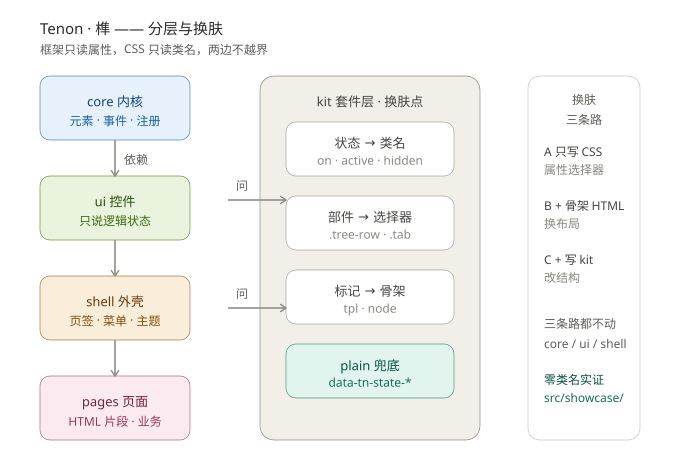

# Tenon（榫）

一个**不打包、不编译、零运行时依赖**的后台微框架。页面只写 HTML，行为靠属性咬合。

> 榫头由控件提供，卯眼由框架预留，靠形状咬合，不用一根钉子。
> 对应到代码：**框架只读属性，CSS 只读类名，两边不越界。**

版本 `2.0.0`；框架 30 个文件 / 4443 行；全局命名空间只有 `window.Tenon`，没有别名。


## 它解决什么问题

后台系统最容易被三件事拖住：构建链越滚越大、组件把业务写死、换一套 UI 要动几百个文件。
Tenon 的对策是把这三件事分别切开：

| 切口 | 做法 | 结果 |
|---|---|---|
| 构建 | 不用打包器，`<script>` 按顺序引入；另附一个生成好的单文件 bundle | 改完刷新即可，没有等待 |
| 逻辑 / 长相 | 控件只写逻辑状态，类名与结构由 kit（皮肤）翻译 | 换 UI 只换 kit + CSS |
| 框架 / 业务 | 页面是 HTML 片段，业务脚本按 `data-script` 懒加载 | 菜单就是 HTML，没有配置文件 |

具体特性：

- **声明即用**：`<table tn-data="table" data-page-size="8">`，扫描器扫到就初始化，页面里没有一行 `new XXX()`
- **皮肤可换三档**：只换 CSS → CSS + 骨架 HTML → 再写 kit，见 `src/showcase/`（零类名实证）
- **零第三方运行时依赖**：唯一外部资源是使用方自己提供的图标字体
- **自检成体系**：274 项断言覆盖框架、bundle、外壳、登录、换肤，全部可无头重跑
- **多应用共存**：`<html data-app="xxx">` 隔离登录态与主题色的存储键
- **可选地址栏同步**：页签条加 `data-sync="hash"`，前进/后退/刷新/分享链接都对得上

## 目录

```
tenon/
├── src/                     ← 框架本体（30 个文件）
│   ├── core/                  命名空间 / DOM / 注册表 / 文案引擎
│   ├── i18n/                  词表（zh-CN 基准 + en）
│   ├── ui/                    套件接口、antd 皮肤、反馈层与 14 个控件
│   ├── shell/                 页签、侧边菜单、请求、登录态、主题
│   ├── showcase/              换肤实证：零类名 + 一份 CSS，没有 kit 文件
│   ├── selftest.html          框架自检（56 条，不引任何皮肤 CSS）
│   ├── tenon.all.js           bundle 产物（保留注释）
│   └── tenon.all.min.js       bundle 产物（压缩版）
├── examples/
│   ├── minimal/               ← 最小起步：外壳 + 一份 CSS + 两个页面片段
│   └── web-admin/             ← 完整演示：antd 皮肤 + 30 个页面 + Mock 数据
├── tools/
│   ├── build.js               打包 + `--check` 漂移检测
│   └── test.js                一把跑完全部回归
└── package.json               只有脚本，没有依赖
```

依赖方向严格单向：**`core` ← `ui` ← `shell` ← `pages`**。



## 快速开始

片段是用 `fetch` 取的，所以需要静态服务（双击 HTML 不行）。**服务根必须是项目根**：

```bash
cd tenon
python -m http.server 8123     # 或 npm run serve
```

然后按目的挑一个入口：

| 入口 | 地址 | 看什么 |
|---|---|---|
| 最简起步 | <http://127.0.0.1:8123/examples/minimal/> | 外壳 + 一份 CSS、两个页面、没有 boot 文件 |
| 完整演示 | <http://127.0.0.1:8123/examples/web-admin/> | antd 皮肤 + 30 个页面（首次落到登录页，任意非空用户名密码即可） |
| 换肤实证 | <http://127.0.0.1:8123/src/showcase/> | 整页零 class，只有一份属性选择器 CSS |
| 框架自检 | <http://127.0.0.1:8123/src/selftest.html> | 56 条断言，可直接用 `file://` 打开 |

想先读代码：从 `examples/minimal/` 开始（`index.html` + `skin.css` + 两个页面片段），
再看 `src/core/tenon.registry.js`（一百来行，整个「声明即用」就在里面）。

## 一个页面长什么样

页面片段没有 `html/head/body`，只有一个根元素：

```html
<div data-page="users" data-script="users">
  <table tn-data="table" data-page-size="8" data-pager="#pager">
    <thead><tr><th data-sort="name">姓名</th><th data-sort="age">年龄</th></tr></thead>
    <tbody>
      <tr data-row-id="1"><td>张伟</td><td>32</td></tr>
      <tr data-row-id="2"><td>李娜</td><td>27</td></tr>
    </tbody>
  </table>
  <div id="pager"></div>
</div>
```

排序、分页、勾选、列宽拖拽全部由这一个属性和几个 `data-*` 参数带来。
控件不回调业务，只派发事件，需要业务逻辑时再写 `pages-script/users.js`：

```js
Tenon.page.define("users", (pane) => {
  pane.addEventListener("tenon:table-change", (e) => {
    // e.detail = { page, total, pages, rows }
  });
});
```

## 接入自己的后台

三步：

1. **引框架**：`<script src="src/tenon.all.min.js"></script>`；想按模块引（省掉用不到的语言包）就照
   `src/README.md` 的「加载顺序」逐个引入。要用登录守卫 / 主题上色的话，那两个文件及其调用要放在 `<head>`。
2. **写外壳**：侧栏菜单就是一段 HTML，但必须留出 `#menu`、`#tabbar`、`#workarea` 三个 id；
   `#tabbar` 上可按需加 `data-home="首页页面名"`、`data-sync="hash"`。
3. **装配三行**：

   ```js
   Tenon.accordion.init();   // 扫描菜单、建索引、绑定折叠与飞出层
   Tenon.navtab.init();      // 页签条、右键菜单、⋮、滚动箭头、地址栏同步
   Tenon.navtab.start();     // 打开首页或地址栏里那一页
   ```

页面片段放哪里由宿主决定（示例是 `pages/*.html`），菜单链接指向片段、由 `Tenon.ajax` 按需 fetch。
换皮肤的三种代价见 `src/README.md` 的「换一套 UI 的三条路」。

## 文档导航

| 想知道 | 看 |
|---|---|
| 框架的分层、加载顺序、属性约定、换肤、事件、i18n、无障碍、自检 | [`src/README.md`](src/README.md) |
| 演示程序有什么、怎么跑、页面/菜单/账号菜单/主题/响应协议 | [`examples/web-admin/README.md`](examples/web-admin/README.md) |
| 最小后台怎么起步（外壳 + CSS + 两个片段） | [`examples/minimal/README.md`](examples/minimal/README.md) |
| 「换 UI 只换 kit + CSS」的三条实证 | [`src/showcase/README.md`](src/showcase/README.md) |

## 常用命令

```bash
npm test                 # 六支用例全跑，按退出码报告（需要本机 Edge/Chrome）
npm run test:verbose     # 失败时把断言原文也打出来
node tools/test.js e2e   # 只跑名字含 e2e 的用例
npm run build            # 重新生成 src/tenon.all.js 与 .min.js
npm run check            # 只校验 bundle 是否与源码一致（提交前 / CI）
npm run serve            # python -m http.server 8123
```

`npm test` 的六支：`selftest`、`bundle`、`bundle-min`（各 56 项）、`e2e`（64 项）、
`login`（11 项）、`showcase`（31 项）。浏览器不在默认路径时用
`TENON_BROWSER=<浏览器路径> npm test` 指定。

## 约定速记

写页面只需要记住四条：

1. **控件用 `tn-data` 声明**：`tn-data="table"`，多个控件空格分隔；少数天生带参数的控件例外
   （`tn-data-dialog` / `tn-data-dropdown` / `tn-data-validate` / `tn-data-toast`）。
2. **控件参数用 `data-<短名>`**：`data-page-size`、`data-sort`、`data-rule`。
3. **外观用 `tn-data-part="名字"` 与 `tn-data-state-名字` 定位**，这两个由 kit 写、CSS 读；
   业务自己的数据用别的属性名（`data-row-id`、`data-view`），永不撞车。
4. **新增控件必须回收资源**：事件委托、定时器、`ResizeObserver` 在 `destroy` 里全部解绑 ——
   页签关闭与刷新都靠它。

硬约束：`#tabbar` / `#workarea` / `#crumb` / `#menu` / `#menu-extra` / `#sider-toggle` / `#theme-trigger`
这些 **id 是外壳与页面之间的契约**，改名会让外壳找不到节点。

## 血统：向 htmx 与 dwz_jui 各借了什么

两个前辈各回答了半个问题：[htmx](https://htmx.org/) 回答「行为怎么声明」，[dwz_jui](https://gitee.com/dwzteam/dwz_jui)
回答「后台长什么样」。Tenon 取两者的交集，再补一件它们都不管的事 —— **声明与长相之间那条缝**（kit 层）。

文件级的对应关系（谁变成了谁）在 [`examples/web-admin/README.md`](examples/web-admin/README.md#与-dwz_jui-的对应关系)；
下面只谈**借的是哪个想法**。

### 从 htmx 借的：声明式超媒体

| 借来的想法 | htmx 的形态 | Tenon 的落点 |
|---|---|---|
| 属性即行为，页面里不写装配代码 | `hx-get` / `hx-target` / `hx-trigger` | `tn-data="table"` + `data-page-size` 等参数，扫描器 `Tenon.init()` 接管 |
| 交换单位是 HTML 片段，不是「JSON + 前端模板拼串」 | 服务端返回片段，`hx-swap` 换进目标 | `pages/*.html` 片段，页签内容就是片段，`ajax.loadInto()` 负责取 |
| 局部替换需要明确的边界 | `hx-target` 圈定范围 | 片段根元素即边界：换之前 `Tenon.destroy(pane)`，换之后 `Tenon.init(pane)` |
| 无构建、渐进增强 | 一个 `<script>` 引完 | `<script>` 按序引入或单文件 bundle；原生 `select` / `input[type=file]` / 表单在没 JS 时照旧可用 |
| 事件是唯一出口 | `hx-trigger` 消费自定义事件 | 控件只派发 `tenon:*`，全部 `bubbles: true`，可在任意祖先一次委托 |

差异在**谁发请求**：htmx 的 `hx-post` 是核心，请求由库发出；Tenon 只保留「加载片段」这一种请求，
业务请求交给宿主 —— `ajax.get/post` 是可整体覆盖的请求器，签名、重试、上传进度这些差异留在业务侧。

### 从 dwz_jui 借的：后台骨架

| 借来的想法 | dwz_jui 的形态 | Tenon 的落点 |
|---|---|---|
| 多页签工作区 | navTab：打开 / 关闭 / 刷新 / 右键 / 关闭其它 | `tenon.navtab.js`（另加首页常驻、⋮ 全部标签、地址栏同步） |
| 服务端说了算的响应协议 | `{ statusCode, message, navTabId, callbackType }` | `ajax.handle()` 原样消化，并多认一个 `skipRefresh` |
| 片段 + 菜单树驱动 | `dwz.frag.xml` 里打包片段与菜单 | 菜单就是 `index.html` 的 HTML，片段是独立文件，改哪页看哪页 |
| 这套组件清单 | dialog / alertMsg / validate / table / pagination / accordion | `ui/` 与 `shell/` 里的同名能力，逐个改写成原生实现 |
| 主题切换 | 多套主题 CSS 换文件 | CSS 变量 + `theme.js`，换主色只改 `--primary` 一族 |
| 单一全局命名空间 | `DWZ` | `Tenon`（无别名，v2.0 已删掉 `DWZ` 与 `data-dwz`） |

### 刻意不借的三件事

| 没借 | 为什么 |
|---|---|
| jQuery | dwz 的插件与选择器都长在它上面；这里需要的是 `qs` / `qsa` / `on` 几十行委托 |
| 类名即约定 | dwz 用 class 组合表达行为（`class="required"` 这类），换皮肤时行为会跟着类名一起改；Tenon 把行为放属性、把类名整体交给皮肤 |
| 组件隐式启动 | dwz 在脚本就绪后按约定自动接管页面，谁先谁后藏在加载顺序里；Tenon 的装配是显式三行（`accordion.init()` → `navtab.init()` → `navtab.start()`），依赖关系看得见 |

一句话：**htmx 给了「怎么声明」，dwz_jui 给了「后台该有什么」，Tenon 补的是「声明与长相解耦」** ——
所以它既有 `tn-data` 这种零 JS 的页面，也有一个可以整体替换的 `kit` 层。

## 已知边界

- **无构建、无模块系统**：文件间靠 `window.Tenon` 与加载顺序耦合。
- **骨架类名归皮肤**：`index.html` 里的 `.app` / `.menu-group` 属于某一套骨架，换皮肤时连同 CSS 与这段 HTML 一起换；`src/shell` 只认 id 与 `data-*`。
- **bundle 是产物，不要手改**：改了 `src/**` 就重跑 `npm run build`，否则与源码脱节（`npm run check` 会报）。
- **登录是纯前端演示**：登录态只是浏览器存储，接真实后端时应改为 token 校验。
- **只测过 Chromium 系**（Edge / Chrome）：自检与回归都跑在无头 Chromium 上。
