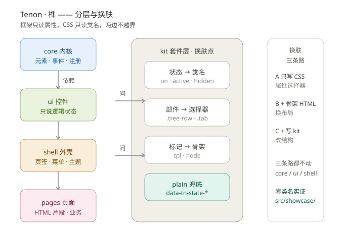

# Tenon（榫）

一个不打包、不编译、零依赖的后台微框架。页面只写 HTML，行为靠属性咬合。

> 榫头由控件提供，卯眼由框架预留，靠形状咬合，不用一根钉子。
> 对应到代码：**框架只读属性，CSS 只读类名，两边不越界。**

框架名 `Tenon`，全局命名空间只有一个 `window.Tenon`，没有别名。

- 框架 30 个文件 / 4443 行（core 346 · i18n 201 · ui 2802 · shell 1094）
- 自检 56 条断言 + 换肤实证 31 条断言 + demo 端到端 64 项 + 登录流程 11 项
- 无构建步骤：`<script>` 按顺序引入即可
- 唯一的第三方依赖是图标字体（由使用方自己提供）

## 标识


两个字标，按尺寸选：

| 文件 | 内容 | 用在哪 |
|---|---|---|
| `tenon-mark.svg` / `.png` | 青色实心方标 + 白 T | favicon、侧栏 logo（小尺寸，对比强） |
| `tenon-icon.svg` / `.png` | 大 T + 小 enon 的字标，无底框 | README 头图、品牌位 |
| `tenon-architecture.svg` | 分层架构图 | 见下方「分层」一节 |

小尺寸用实心色块、大尺寸用纯字——前者靠对比度在 16px 站得住，后者靠字距在版面上好看。

比例上 T 取 1:1.25（宽:高），贴近西文大写 T 的字形骨架，比黄金比 1:1.618 更耐缩小——
后者在 32px 时竖笔只剩 3px，糊成一团。

## 上手

不想先读几千行：**`examples/minimal/`** 是四个文件跑起来的最小后台
（外壳 + 一份 CSS + 两个页面片段，片段里没有一行 JS），跑法见那里的 README。

它刻意用「bundle + 裸套件 + 属性选择器 CSS」这条路 —— 读完就知道换肤是怎么回事。
想改框架本身，再往下看分层。

## 分层

依赖方向严格单向，箭头表示「被依赖」：

```
core  ←  ui  ←  shell  ←  pages
```



| 层 | 知道什么 | 不知道什么 |
|---|---|---|
| `core` | 元素、事件、选择器、文案 | 任何类名、颜色、尺寸 |
| `ui` | 逻辑状态名、逻辑部件名 | 物理类名（交给 kit） |
| `shell` | 外壳骨架：页签条、侧边菜单、路由 | 业务数据 |
| `pages` | 业务数据与交互 | 框架内部实现 |

判定一个文件该放哪，只问两句话：

1. **这文件知道类名吗？** 知道 → 不能进 `core`。
2. **换掉皮肤之后要不要改？** 要改 → 它是 kit，不是控件。

两问答案不一致，说明这个文件干了两件事，该拆。

## 文件清单

### core —— 内核（4）

| 文件 | 职责 |
|---|---|
| `tenon.core.js` | 建命名空间、写版本号、声明属性前缀。无逻辑，必须最先加载 |
| `tenon.dom.js` | `qs` `qsa` `el` `on` `esc` `pad2` `num`，事件一律委托 |
| `tenon.registry.js` | 组件注册表与扫描器：`component` `get` `init` `destroy` `ready` |
| `tenon.i18n.js` | 文案引擎：`t` `define` `use` `resolve` `apply`（不含词条） |

### i18n —— 词表（2）

| 文件 | 内容 |
|---|---|
| `tenon.zh-CN.js` | 简体中文词条，**基准语言**；其它语言缺词条时回落到这里 |
| `tenon.en.js` | 英文词条。`en` / `en-US` / `en-GB` 都解析到它 |

一个语言一个文件，只放 `Tenon.i18n.define("xx", { … })`，没有逻辑。
加新语言：复制一份改名 + 换 key，再在页面里多引一行。

### ui —— 控件与套件（19）

套件（皮肤）：

| 文件 | 职责 |
|---|---|
| `tenon.kit.js` | 套件接口 + `plain` 兜底实现（无类名，靠属性表达状态） |
| `tenon.kit.antd.js` | Ant Design 皮肤：状态名→类名、部件名→选择器、片段标记、外壳骨架 |

反馈类：

| 文件 | 职责 |
|---|---|
| `tenon.ui.js` | `toast` `modal` `confirm` `loading` 的编排（开几层、怎么关） |
| `tenon.dialog.js` | 声明式弹窗触发器 `tn-data-dialog` |
| `tenon.dropdown.js` | 下拉菜单 `tn-data-dropdown`，视口夹取定位 |
| `tenon.popover.js` | 「触发器 + 浮层」的公共开关：开/关/点外面/Esc/aria-expanded。select 与 cascader 共用 |

控件（声明即用，靠 `tn-data` 被扫描）：

| 文件 | 控件名 | 参数 |
|---|---|---|
| `tenon.tabs.js` | `tabs` | `data-tab` / `data-pane` |
| `tenon.switch.js` | `switch` | 派发原生 `change`（`detail.on`） |
| `tenon.collapse.js` | `collapse` | `data-collapse` 触发器、`tn-data-accordion` 手风琴 |
| `tenon.segmented.js` | `segmented` | `data-seg` |
| `tenon.rate.js` | `rate` | `data-value` |
| `tenon.optionlist.js` | `optionlist` | `data-option` |
| `tenon.select.js` | `select` | 增强原生 `<select>`：`multiple` `data-placeholder` `data-search` |
| `tenon.cascader.js` | `cascader` | 增强原生 `<select>`：层级用 `data-parent` 描述 |
| `tenon.upload.js` | `upload` | 增强原生 `<input type="file">`：`data-max-size` `data-max-count` `data-accept-hint` |
| `tenon.tree.js` | `tree` | `data-node` / `data-caret`（`1` 可展开、`0` 叶子） |
| `tenon.table.js` | `table` | `data-page-size` `data-pager` `data-sort` `data-sort-key` `data-sort-dir`、`data-check` `data-check-all` `data-row-id`、`data-resize="off"` 关掉列宽拖拽、`data-sticky="head,1"` 固定表头与前 N 列、`data-virtual` 开虚拟滚动 |
| `tenon.form.js` | `form` | `tn-data-validate` `data-rule` `data-msg` `data-action` `data-tab` |
| `tenon.chart.js` | — | 纯函数绘图，不注册控件 |

### shell —— 外壳（5）

| 文件 | 职责 |
|---|---|
| `tenon.navtab.js` | 页签：打开 / 关闭 / 右键菜单 / 全部标签视图 / 按需 fetch 片段 |
| `tenon.accordion.js` | 侧边菜单折叠、飞出层、高亮 |
| `tenon.ajax.js` | 片段加载、脚本按需加载、响应协议处理；`get`/`post` 是默认走 fetch 的请求器，宿主可覆盖 |
| `tenon.auth.js` | 登录态与守卫（不依赖 `tenon.dom`，可在 `<head>` 跑） |
| `tenon.theme.js` | 主题色写入 CSS 变量、设置抽屉 |

外壳的「装配」（先 init 谁、账号菜单有哪些动作）不在这里 —— 那是宿主的事，
`examples/web-admin/demo/demo.boot.js` 与 `showcase/index.html` 各写各的，见「启动顺序」一节。

### 根目录

| 文件 | 职责 |
|---|---|
| `selftest.html` | 自检页。刻意不引任何皮肤 CSS，用来证明框架行为自成一体 |
| `selftest.js` | 56 条断言：core / registry / kit / 骨架 / 12 个控件 / 反馈链路 / 收尾检查 |
| `showcase/` | 换肤实证：零类名的后台，只有一份 CSS，没有 kit 文件（见 `showcase/README.md`） |
| `tenon.all.js` | **生成物**：30 个模块合成一个文件（保留注释，便于调试） |
| `tenon.all.min.js` | **生成物**：压缩版，约 100 KB |
| `selftest.bundle.html` | 用 bundle 跑同一套断言，加 `?min` 则测压缩版 |
| `../tools/build.js` | 打包 + `--check` 漂移检测 |
| `../tools/test.js` | 一把跑完全部回归，按退出码报告 |

## 加载顺序

顺序不是风格问题，是依赖关系。照抄：

```html
<!-- <head>：命名空间 → 主题 → 鉴权 → 守卫 -->
<script src="src/core/tenon.core.js"></script>
<script src="src/shell/tenon.theme.js"></script>
<script src="src/shell/tenon.auth.js"></script>
<script>Tenon.auth.guard();</script>

<!-- <body> 末尾：内核 → 套件 → 反馈 → 控件 → 外壳 -->
<script src="src/core/tenon.dom.js"></script>
<script src="src/core/tenon.registry.js"></script>

<!-- 文案引擎在前，词表在后：基准语言先上，其它按需 -->
<script src="src/core/tenon.i18n.js"></script>
<script src="src/i18n/tenon.zh-CN.js"></script>
<script src="src/i18n/tenon.en.js"></script>

<script src="src/ui/tenon.kit.js"></script>
<script src="src/ui/tenon.kit.antd.js"></script>

<script src="src/ui/tenon.ui.js"></script>
<script src="src/shell/tenon.ajax.js"></script>
<script src="src/ui/tenon.dropdown.js"></script>

<!-- 其余控件按需，注册顺序无所谓 -->
<script src="src/ui/tenon.tabs.js"></script>
<!-- … -->

<script src="src/shell/tenon.navtab.js"></script>
<script src="src/shell/tenon.accordion.js"></script>

<!-- 装配由宿主自己写，框架不提供 boot 文件 -->
<script>
  Tenon.accordion.init();   // 读 HTML 建菜单索引、绑定折叠
  Tenon.navtab.init();      // 页签条、右键、⋮、地址栏同步
  Tenon.navtab.start();     // 打开初始页签（地址栏有值就打开那一页）
</script>
```

两条硬约束：

1. `tenon.core.js` 必须第一个。`theme.js` / `auth.js` 要在 `<head>` 里就跑，它们先于 DOM 工具。
2. `tenon.kit.js` 必须在 `tenon.kit.antd.js` 之前，否则 `use()` 无处可挂。

## 单文件 bundle

不想引 26 个 `<script>` 就用生成的 bundle：

```html
<head>
  <script src="src/tenon.all.js"></script>
  <script>Tenon.auth.guard();</script>
</head>
```

两个产物：

| 文件 | 大小 | 用途 |
|---|---|---|
| `tenon.all.js` | 约 166 KB | 合并版，保留注释与分隔标记，出问题好定位 |
| `tenon.all.min.js` | 约 100 KB | 去掉注释与缩进（压掉约 38%），线上用这个 |

bundle 里带了两份词表（zh-CN / en）。只想要一种语言、又在意体积：
别用 bundle，按「加载顺序」自己引 `core/tenon.i18n.js` + 需要的那份 `i18n/*.js`。

**放 `<head>` 里**：`tenon.auth` 的跳转和 `tenon.theme` 的上色都要求早于 DOM，
demo 里那两个文件本来就在 head 中，bundle 把顺序带过来了。

重新生成：

```bash
node tools/build.js            # 生成
node tools/build.js --check    # 只校验产物是否最新（CI / 提交前跑）
```

压缩器是脚本里自带的一百来行：只做「去注释 + 压空白」，不动任何 token，
也保留换行（ASI 依赖换行）。环境里没有 terser/esbuild，这个项目也不打算为了打一个包去装它们。

**bundle 是产物，不要手改**。改了哪个模块就重跑一次脚本，否则它和源码必然脱节。
它的等价性由 `selftest.bundle.html` 保证：同一套断言分别跑 `tenon.all.js`、
`tenon.all.min.js`（`?min`），都得全绿。实测 demo 换成 `tenon.all.min.js`
单文件后，64 项端到端也照旧全过。

## 三个核心 API

```js
/* 1. 注册一个控件 */
Tenon.component("rate", {
  selector: '[tn-data~="rate"]',   // 只读属性，不读类名
  init(el, root) { /* 返回实例或 null */ },
  destroy(el, instance) { /* 回收监听与定时器 */ }
});

/* 2. 扫描并初始化（页面片段插入 DOM 后调用） */
Tenon.init(rootElement, ["rate"]);  // 第二个参数可只初始化指定控件

/* 3. 取回实例 */
const inst = Tenon.get(el, "rate");
inst.set(4);
```

`Tenon.init` 幂等：初始化过的节点会打上 `tn-data-done="<控件名>"`，重复调用不会重入。
`Tenon.destroy(root)` 会调 `destroy`、删 `el.__tn` 实例表、摘掉 `tn-data-done`，供页签关闭/刷新时回收。

### 公共 API 一览

挂在 `window.Tenon` 上的就是全部对外接口：

| 命名空间 | 成员 |
|---|---|
| 版本 | `version` `PREFIX` `attr(suffix?)` |
| 控件注册 | `component(name, def)` `get(el, name)` `init(root, only?)` `destroy(root)` `ready(fn)` |
| `core` | `qs` `qsa` `el` `on` `esc` `pad2` `num` |
| `i18n` | `t(key, vars?)` `define(locale, dict)` `use(locale)` `apply(root?)` `current` `locales()` |
| `kit` | `use` `reset` `current` `name` `setState` `hasState` `part` `node` `tpl` `icon` `pager` `count` `tag` `emptyRow` `confirm` `toast` `modal` `loading` `menu` |
| `ui` | `toast` `modal` `confirm` `loading` |
| `popover` | `create({ wrap, trigger, panel, onOpen, onClose })` |
| `dropdown` | `open` `close` `isOpen` |
| `form` | `validate` `serialize` `checkField` `rules` |
| `ajax` | `get` `post` `handle` `loadInto` `fetchPage` `parse` `require` |
| `page` | `define(name, fn)` |
| `navtab` | `init` `start` `open` `close` `closeOthers` `closeAll` `refresh` `refreshOrOpen` `currentId` `initialId` `HOME` |
| `accordion` | `init` `highlight` `hideFlyout` `buildIndex` `isCollapsed` |
| `auth` | `user` `login` `logout` `guard` `KEY` |
| `theme` | `apply` `open` `presets` |
| 只读数据 | `menuMap`（菜单索引，由 accordion 扫描静态菜单生成） |

**没有别名**。早期为了兼容 dwz_jui 留过 `Tenon.define` / `Tenon.http` / `Tenon.tabs`，
已经全部删掉 —— 同一个东西给两个名字，最后没人记得哪个是真的。

## 属性约定

属性分**两层**，边界是「这个名字属于谁」：

| 类别 | 形态 | 用途 |
|---|---|---|
| 框架命名空间 | `tn-data="a b"` | 声明「这里是什么控件」，空格分隔可多值 |
| | `tn-data-<参数>` | 框架内部参数，如 `tn-data-accordion` |
| | `tn-data-done` | 扫描器写的内部标记，不要手写 |
| | `tn-data-part="x"` | 皮肤要定位的部件（裸套件下由页面手写） |
| | `tn-data-state-<名>` | 逻辑状态，框架写、CSS 读 |
| | `tn-data-i18n="key"` | 文案标记：文本 / `-ph` 占位符 / `-title` 标题 |
| 控件公开参数 | `data-<短名>` | `data-page-size="8"` `data-rule="required"` `data-page` |

### 例外：参数兼作声明

有四个控件**天生就需要一个参数**，那个参数就是声明，不再额外写 `tn-data`：

| 属性 | 控件 | 兼作的参数 |
|---|---|---|
| `tn-data-dialog="basic"` | dialog | 用哪个模板 |
| `tn-data-dropdown="编辑\|复制\|删除"` | dropdown | 菜单项 |
| `tn-data-validate` | form | 「这个表单要校验」 |
| `tn-data-toast="success"` | ui | 提示类型 |

理由很实际：`<button tn-data="dialog" tn-data-dialog="basic">` 是把同一件事写两遍。
`tn-data` 的价值在于**给「没有天然参数的控件」一个统一入口**，不是逼所有控件都长两截。

前缀写在 `Tenon.PREFIX`（当前 `"tn-data"`），运行期属性名由 `Tenon.attr(suffix)` 拼出。
但别指望「改一个常量就全站改名」：**静态选择器和页面标记要一起改**，它只是单一来源。

**外壳与套件之间的契约属性**（`data-tab-id` `data-pick` `data-ctx` …）也落在 `data-*`
这一层：它们由外壳写、外壳读，属于「接口」而不是「框架命名空间」。

这条不是口头的：自检里有一条断言盯着 —— **每个控件的选择器都必须含 `Tenon.PREFIX`**，
且 `node()` / `setState()` / `part()` / `tpl()` 运行时产出的属性名也都得带上它。
新加控件时忘了这条约定，自检会红。

后两种属性的名字一律 **kebab-case**：代码里叫 `siderCollapsed` / `errorText`，
落到 HTML 就是 `tn-data-state-sider-collapsed` / `tn-data-part="error-text"`。

业务自己的数据用别的名字（`data-row-id`、`data-user`、`data-view`…），与框架属性永不撞车。

## 换皮肤（kit 层）

控件与外壳只说逻辑状态、逻辑部件与骨架，翻译工作全在 kit。

```js
/* 控件这样写 —— 全程不出现类名 */
Tenon.kit.setState(item, "open", true);                  // 状态
Tenon.kit.hasState(item, "open");
box.querySelector(Tenon.kit.part("sortArrow"));          // 部件
box.innerHTML = Tenon.kit.pager(page, pages, total);     // 片段
```

```js
/* 外壳这样写 —— 容器交给 node，标记交给 tpl */
const btn = Tenon.kit.node("tab");                       // <div class="tab">
btn.innerHTML = Tenon.kit.tpl("tab", { id, title, fixed });
panel.innerHTML = Tenon.kit.tpl("flyout", { title, items });
icon.className = Tenon.kit.icon("fold");                 // 图标字体也是皮肤
```

| API | 输入 | antd 皮肤 | plain 兜底 |
|---|---|---|---|
| `setState` / `hasState` | `on` `open` `active` `hidden` `sorted` `error` `show` `disabled` `empty` `fixed` `ctxTarget` `hasActive` `flyoutOn` `collapsed` `siderCollapsed` | 对应类名 | `tn-data-state-<名>` 属性 |
| `part(name)` | `app` `sider` `menuGroup` `menuTitle` `field` `sortArrow` `swatch` … | 选择器 | `[tn-data-part="名"]` |
| `node(name)` | `tab` `pane` `dropdown` `moreMenu` `flyout` `themeMask` `themeDrawer` | 带类名的空节点 | 带 `tn-data-part` 的空节点 |
| `tpl(name, data)` | `tab` `crumb` `empty` `divider` `pickItem` `pickAction` `ctxItem` `flyout` `themeDrawer` | 骨架 HTML | 同结构、零类名 |
| `icon(name)` | `fold` `unfold` | Font Awesome 类名 | 空串 |

`tpl` 的入参里只有内容与契约属性（`data-*`、`href`），**是否加类名由套件决定**，
所以同一份外壳代码在裸套件下也能跑出完整逻辑。

### 外壳与套件的分界

| 归外壳（`src/shell`） | 归套件（`tenon.kit.*.js`） |
|---|---|
| id 契约：`#tabbar` `#workarea` `#crumb` `#tab-more` `#menu` `#menu-extra` `#sider-toggle` `#theme-trigger` | 类名：`.tab` `.pane` `.menu-group` `.flyout-item` `.theme-drawer` … |
| `data-*` 契约：`data-tab-id` `data-tab-close` `data-tab-scroll` `data-pick` `data-pick-close` `data-pick-act` `data-ctx` `data-group` `data-view` `data-color` `data-picker` `data-reset` `data-close` | 标签结构与文案位置：页签里谁在前面、菜单项右侧放不放快捷键 |
| 四个可配项：`#tabbar[data-home]` 首页页签 id、`#tabbar[data-sync="hash"]` 地址栏同步、`<html data-app>` 存储键前缀、`<html data-primary>` 默认主色 | 主题预设色板、抽屉的版式 |
| 状态机：什么时候开、什么时候收、收几个 | 状态怎么落到 DOM：类名、属性、还是别的 |

判据：`grep -n "class" src/shell/*.js` 只剩 `icon.className = Tenon.kit.icon(...)`
一句，以及注释里的示例。类名字面量已经清零。

### 换一套 UI 的三条路

按代价从低到高，能停在第一条就别往下走：

| 路线 | 要写什么 | 适合 | 实证 |
|---|---|---|---|
| **A. 只写 CSS** | 一份吃 `[tn-data-part="…"]` 与 `[tn-data-state-…]` 的样式表 | 结构沿用，只换质感与配色 | `src/showcase/` |
| **B. CSS + 骨架 HTML** | A + 首页那段骨架（`.app` / `menu-group` / `tabbar-wrap`） | 布局也要换 | `examples/web-admin/` 换掉 `index.html` 即可 |
| **C. 再写 kit** | B + `tenon.kit.<名字>.js`，覆盖 `tpl()` 等 | 连页签、菜单的结构都要不一样 | `tenon.kit.antd.js` |

三条路都**不动** `src/core`、`src/ui` 的控件、`src/shell` 的任何一行。

路线 A 是这条设计的底线：`plain` 兜底实现把状态写成 `tn-data-state-<名>`、
把部件写成 `[tn-data-part="名"]`、把骨架渲染成不带类名的等价结构，
所以一份纯属性选择器的 CSS 就能画出完整界面 —— 连 kit 文件都不需要。
`src/showcase/` 就是这么做的，它的断言里有一条很难糊弄：

```
整页 class 属性为 0 个
```

## 地址栏同步（可选）

给 `#tabbar` 加 `data-sync="hash"`，当前页签就和地址栏绑在一起：

```html
<div class="tabbar" id="tabbar" data-home="dashboard" data-sync="hash"></div>
```

| 动作 | 结果 |
|---|---|
| 打开 / 切换页签 | 地址栏变成 `#/users`（push，可以后退） |
| 前进 / 后退 | 切回对应页签；那个页签已经关了就地重开 |
| 刷新页面 | 从地址栏那一页进来，不是回首页 |
| 关掉当前页签 | 用 replace 落到新的当前页，不往历史里堆垃圾 |
| 全部关完 | 地址栏清空，工作区显示「请选择左侧菜单」 |

写入点只有 `activate()` 一处 —— 所以从菜单、面包屑、⋮ 列表、右键刷新、页面脚本
哪一种入口进来，地址栏都会跟上，不用各自记得写。

不开启时一切照旧（默认关），此时启动方式是 `Tenon.navtab.open(某个 id)`；
开启后建议改用 `navtab.start()`，它把「从哪一页开始」收成一个出口：

```js
Tenon.navtab.init();
Tenon.navtab.start();            // = open(地址栏里的 id || 首页)
Tenon.navtab.initialId();        // 想知道它选了谁
```

## 多应用共存

`<html data-app="my-admin">` 决定存储键的前缀，不写就是 `tenon`：

| 键 | 存什么 |
|---|---|
| `<app>:user` | 登录态（勾「记住我」写 localStorage，否则 sessionStorage） |
| `<app>:primary` | 主题主色 |

同一个域名下挂两个后台时（`/admin-a`、`/admin-b`），不加这一项会互相顶掉登录态与主色。
演示程序声明的是 `data-app="web-admin"`，与它历史数据兼容。

## 事件

控件不回调业务，只派发事件，页面脚本自己听：

| 事件 | 源于 | detail |
|---|---|---|
| `tenon:tab` | tabs | `{ key }` |
| `change`（原生） | switch | `{ on }` |
| `tenon:collapse` | collapse | `{ item, open }` |
| `tenon:segment` | segmented | `{ value, index }` |
| `tenon:rate` | rate | `{ value }` |
| `tenon:option` | optionlist | `{ index, text, node }` |
| `tenon:select` | select | `{ values, value, options }`（另有原生 `change`） |
| `tenon:cascader` | cascader | `{ value, labels }`（另有原生 `change`） |
| `tenon:upload` | upload | `{ files, rejected, reason }`（另有原生 `change`） |
| `tenon:tree-select` | tree | `{ id, text, row }` |
| `tenon:table-change` | table | `{ page, total, pages, rows }` |
| `tenon:table-select` | table | `{ selected }` |
| `tenon:table-resize` | table | `{ index, width }` |
| `tenon:form-submit` | form | `{ data, form }` |
| `tenon:dropdown` | dropdown | `{ text, index }` |

全部 `bubbles: true`，所以在任何祖先节点上都能一次委托。

### 表格列宽拖拽

默认开启，列头右缘会多一根 7px 宽的把手（由 `kit.node("colResizer")` 造，长相归皮肤）。
拖动时表格切到 `table-layout: fixed` 并生成 `colgroup` 记住各列宽度，松手派发
`tenon:table-resize`。不想要就在标签上写 `data-resize="off"`。

之所以要先测一遍所有列宽再切 fixed：`auto` 布局下浏览器把 `width` 当最小值，
拖窄了不生效，拖宽了又会撑破其它列。

### 固定表头 / 固定列

```html
<table tn-data="table" data-sticky="head,1">
```

- `head` —— 表头吸顶
- 数字 N —— 前 N 列吸附到左侧
- 外层容器要有高度并 `overflow: auto`（例如给 `.table-wrap` 加 `max-height`）

框架给该吸附的格子打 `tn-data-sticky="head col"`，算出每列的 `left`，
并给**最后一个冻结列**加 `edge`（皮肤据此在接缝处画投影，否则滚过去的内容会贴着冻结列）
（按实测宽度累加，所以**拖过列宽后会自动重算**）。`position: sticky`、底色、层级全在皮肤里。

一个坑值得记下来：皮肤的 `.table th { position: relative }`（给列宽把手做定位）权重高于
`[tn-data-sticky] { position: sticky }`，会把 sticky 顶掉。正确写法是
`.table th:not([tn-data-sticky])`，或者把吸附规则提到 `.table [tn-data-sticky]`。

## 国际化

框架只说**自己那几句话**（分页、空态、右键菜单、确定/取消、占位提示）。
页面正文由宿主处理 —— 框架不去猜哪段是业务文案。

```js
Tenon.i18n.use("en");                       // 切换（自带 zh-CN / en）
Tenon.i18n.t("pager.total", { n: 12 });     // "{n} in total" → "12 in total"
Tenon.i18n.define("ja", { "pager.prev": "前へ" });    // 补一套，缺的自动回落
```

页面标记：

```html
<span tn-data-i18n="ui.ok"></span>               <!-- 文本 -->
<input tn-data-i18n-ph="select.search">         <!-- placeholder -->
<span tn-data-i18n-title="navtab.more"></span>  <!-- title -->
```

| 规则 | 说明 |
|---|---|
| 查找顺序 | 当前语言 → `zh-CN`（基准）→ 返回 key 本身。缺词条露 key，别静默空掉 |
| 单复数 | 词条可写成 `{ one, other }`，传 `n` 自动取（中文两栏相同即可） |
| 初始语言 | `<html lang>` 认得就用，否则 `zh-CN` |
| 语言码 | 做前缀解析：`en-US` / `en-GB` → `en`，`zh-Hans` → `zh-CN`；认不得的退回基准 |
| 加载顺序 | `core/tenon.i18n.js` → `i18n/tenon.zh-CN.js` → 其它语言（按需） |
| 切换之后 | 同步 `<html lang>`、重译文档标记、派发 `tenon:lang`；**已挂载的控件会自己重绘**（分页器、占位、空态），不用重新初始化 |
| 词条组织 | 平铺的 `模块.用途` key，两张表都在 `tenon.i18n.js` 里 |

### 宿主内容怎么配合

菜单文字、页签标题、面包屑这些是**宿主的内容**，框架不碰。要一起翻，
宿主在切语言时改好菜单文字，再调一次 `Tenon.navtab.relabel()` 让已打开的页签重读一遍 ——
`examples/web-admin/demo/demo.i18n.js` 就是这么做的（30 个页面名 + 6 个分组各配一份英文）。

**没做什么**：不翻译页面正文、不做懒加载语言包、不做复数以外的语法规则。
这三件事要么属于宿主，要么需要引入体积 —— 现在这套够把框架自己的文案说清就够了。

## 无障碍与键盘

框架只补**语义**，不管长相（长相仍是 kit 的事）：

| 控件 | ARIA | 键盘 |
|---|---|---|
| `tabs` | `role=tablist` / `tab` / `tabpanel`、`aria-selected`，未选中项 `tabindex=-1` | `←` `→` 切换并跟随焦点，`Home` `End` 到两端 |
| `table` | 排序列头 `aria-sort="ascending｜descending｜none"` | 列头本身可点；排序状态对读屏可见 |
| `select` | `listbox` / `option`、`aria-selected`、`aria-expanded` | `↑` `↓` `Home` `End` 移动焦点，`Enter` 选中，`Esc` 收起 |
| `cascader` | 每列 `role=group`、项 `role=menuitem` | `↑` `↓` 同列移动，`→` 下钻，`←` 回上一列，`Enter` 选中 |
| `popover`（共用） | `aria-expanded` 跟着开合 | `Esc` 收起并把焦点还给触发器 |

两个约定：

1. **初始态由 HTML 决定，框架只补语义**。选项卡初始化时只写 `aria-selected` / `tabindex`，
   不改哪些按钮是「选中」——可见性照旧是 HTML 说了算。
2. **整条选项卡栏只有一个 Tab 落点**（非选中项 `tabindex=-1`），进去之后用 `←` `→` 走，
   这是 WAI-ARIA 的 tablist 惯例。

## 请求器与响应协议

`tenon.ajax` 里框架真正拥有的是两样：

| 能力 | 函数 | 干什么 |
|---|---|---|
| 片段加载 | `loadInto(holder, url, id)` | fetch 一个 `pages/*.html` 片段，扫描控件、按需加载 `pages-script/*.js` |
| 响应协议 | `handle(res, ctx)` | 消化 `{ statusCode, message, callbackType, navTabId }`，决定关页签 / 刷新 / 开新页签 |

而 `get(url, params)` / `post(url, data)` 是**请求器**，默认走 `window.fetch`（接真实后端）。
换数据源不用改框架——直接覆盖它：

```js
// 接 axios、mock、或任何自研请求层，都行
Tenon.ajax.post = async (url, data) => myClient.post(url, data);
```

`examples/web-admin/mock/db.js` 就是这么干的：它用自己的实现读 `MOCK_ROUTES` 并加了点延时，
覆盖掉默认 fetch。删掉那个文件，demo 就自动切回真实 fetch。

这样切分后，框架里没有一行 mock、没有一行「演示用延时」——那些都在宿主侧。

### 文件选择

```html
<input type="file" tn-data="upload" multiple
       data-max-count="3" data-max-size="5" data-accept-hint="支持 pdf / png / jpg">
```

点击或拖拽都行，列表可删单个文件。**选中的文件同步回原生 input**，
所以 `new FormData(form)` 照旧拿得到；关掉 JS 时它还是个能用的文件框。

| 参数 | 含义 |
|---|---|
| `data-max-size` | 单个文件上限（MB），超了跳过并提示 |
| `data-max-count` | 最多几个；不写时单选为 1、多选不限 |
| `data-accept-hint` | 只显示给人看的说明（真正的类型过滤交给原生 `accept`） |

**只管「选」，不管「传」**：上传进度、分片、直传、断点续传各家都不一样，框架不猜。
实例 API：`files()` / `count()` / `add(fileList)` / `remove(i)` / `clear()`。

### 虚拟滚动

```html
<div style="height:400px;overflow-y:auto">
  <table class="table" tn-data="table" data-virtual>…</table>
</div>
```

上千行只渲染可视窗口（通常 20 行上下），靠 tbody 里上下两根占位行撑出总高度。
实测 2000 行：DOM 里 19 行、初始化 80ms 左右。

几个约定：

- **外层容器必须有固定高度并 `overflow-y:auto`**。找不到滚动祖先就自动退回整表渲染，不会出错
- 与 `data-page-size` **互斥**（写了分页就按分页走）
- 行高假设是统一的：首屏渲染后量一次真实行高，和预估值差得多就按实测值重画
- 滚动重绘是**静默**的，不会每滚一帧就派发 `tenon:table-change`
- 虚拟模式下「全选」作用于**整个筛选结果**——窗口会随滚动变化，只勾当前窗口会让勾选状态乱跳

### 下拉选择

```html
<select tn-data="select" multiple data-search data-placeholder="选择成员">
  <option value="">请选择</option>
  <option value="1" selected>张伟</option>
  <option value="2">李娜</option>
  <option value="3" disabled>王强（停用）</option>
</select>
```

页面写原生 `select`，控件把它藏起来、换成面板，**选中状态同步回原生节点**。
这样 `new FormData(form)`、表单校验、老代码里的 `sel.value` 全都不用改；
关掉 JS 时它还是个能用的下拉。

- 首项 `value=""` 视为「未选」，占位文案才会出现（原生默认选中首项）
- 多选默认带搜索框；单选加 `data-search` 也开
- 实例 API：`get() / set(values) / open() / close() / refresh()`
- 面板开关走 `Tenon.popover`，和级联选择共用同一套「点外面 / Esc / aria-expanded」行为

### 级联选择

```html
<select tn-data="cascader" data-placeholder="选择地区">
  <option value="330000">浙江省</option>
  <option value="330100" data-parent="330000">杭州市</option>
  <option value="330102" data-parent="330100">上城区</option>
  <option value="320000">江苏省</option>
</select>
```

层级用 `data-parent` 指向父节点的 `value`，不用嵌套 `<optgroup>`——**HTML 解析器会把
内层 optgroup 拆平**，拿到的 DOM 没有层级。扁平 option + 父子引用才是能活下来的写法，
FormData 也照旧。

- 被当作 `data-parent` 引用的节点是**分叉**，点了往里钻，不可选
- 没有子节点的叶子才可选，选中后写回原生 option
- 原生 select 默认选中首项，若首项恰是分叉，初始化时会 `selectedIndex = -1` 清掉

最后这条有个坑：单选框一旦「没有选中项」，浏览器会立刻回选第一个可选项，
所以 `option.selected = false` 是**无效**的，必须用 `selectedIndex = -1`。

面板开关同样走 `Tenon.popover`，所以「点外面收起」「Esc 收起」「aria-expanded」
和下拉选择是同一套实现。

## 新增一个控件

1. 新建 `src/ui/tenon.<名字>.js`；
2. `Tenon.component("<名字>", { selector: '[tn-data~="<名字>"]', init, destroy })`；
3. `init` 里只用 `Tenon.kit.setState / hasState / part`，不写类名；
4. 需要用户操作反馈就派发 `tenon:<名字>`，不要直接调业务函数；
5. 有定时器、全局监听、`ResizeObserver` 之类，必须在 `destroy` 里回收，并把解绑函数放进实例；
6. 加进宿主页面的 `<script>` 列表；
7. 用法示例写在文件头注释里，**示例里的 `tn-data` 不能省**。

## 自检

`src/selftest.html` 是这套约定的安全网，56 条断言，打开即跑（`file://` 直接打开即可，不需要起服务）：

| 组 | 条数 | 守的是 |
|---|---|---|
| core / registry | 6 | 转义、选择器、注册幂等、`destroy` 回收、局部扫描 |
| kit 状态与片段 | 4 | 状态映射、部件回落、`use/reset` 可切换、片段带总数 |
| kit 骨架 | 3 | `node/tpl/icon` 在皮肤下对得上；**裸套件下产出零类名**；`node()` 造的部件 `part()` 必须查得到 |
| 控件 | 25 | 12 个控件的逻辑态与事件（含表格勾选跨排序/翻页、列宽拖拽、固定表头/列、虚拟滚动窗口与 setData、下拉回写原生 select） |
| 表单与弹层 | 4 | 必填校验、可扩展规则、声明式弹窗、声明式下拉 |
| 反馈链路 | 4 | toast / loading / confirm / modal |
| 约定 | 1 | 控件选择器必须走 `tn-data`，或在「参数兼作声明」的例外表里 |
| 请求协议 | 1 | `ajax.handle` 认 statusCode / callbackType / navTabId / skipRefresh |
| 国际化 | 3 | `t()` 的查找顺序与占位替换；框架文案与 `tn-data-i18n` 标记跟着语言走 |
| 无障碍 | 3 | 选项卡 role/aria-selected/方向键、表格 aria-sort、下拉与级联的键盘操作 |
| 其它 | 2 | 图表纯函数、收尾无残留浮层与夹具 |

页面**刻意不引任何皮肤 CSS**：能跑通说明行为不依赖样式。
断言只读逻辑状态（`kit.hasState` / 实例 API），从不读计算样式——那是皮肤的事。

### 一把跑完全部

```bash
npm test                        # 六支全跑，打一张表
npm run test:verbose            # 失败时把断言原文也打出来
node tools/test.js e2e login    # 只跑名字含 e2e / login 的
```

`tools/test.js` 自己找本机的 Edge/Chrome（也可用 `TENON_BROWSER=<路径>` 指定），
用 `file://` + `--allow-file-access-from-files` 打开各套页面，
从 DOM 里读「共 N 项 通过 P 失败 F」，汇总后**以退出码报告结果** —— 接 CI 只要一行。

实测输出：

```
  ✓ selftest     56/56   框架自检（逐个模块）
  ✓ bundle       56/56   同一套断言跑 tenon.all.js
  ✓ bundle-min   56/56   同一套断言跑 tenon.all.min.js
  ✓ e2e          64/64   antd 皮肤 + 外壳 + 30 页全量
  ✓ login        11/11   登录 / 退出 / 记住我
  ✓ showcase     31/31   换肤实证（零类名）
合计 274/274 项，全绿
```

改动任何 `src/**` 之后跑一遍，比逐页点菜单快得多。

结果同时写到页面和 `window.__selfTest = { total, passed, failed, results }`，
所以也可以自己拼命令单跑某一支：

**不想起服务也行**：三支都能直接用 `file://` 跑，只要给浏览器加
`--allow-file-access-from-files`（片段是用 fetch 取的，不加这个参数会被拦）：

```bash
msedge --headless=new --allow-file-access-from-files --virtual-time-budget=60000 \
  --dump-dom "file:///<项目根>/examples/web-admin/e2e.html" | grep -o '通过.*失败'
```

另外两支，改完皮肤或外壳都要跑：

| 入口 | 项数 | 管什么 |
|---|---|---|
| `examples/web-admin/e2e.html` | 64 | 框架 + antd 皮肤 + 那套外壳合起来跑不跑得动，附 30 页全量、深链接、各浮层的 Esc / 点外面 |
| `examples/web-admin/e2e-login.html` | 11 | 登录页：空提交报错 / 登录进后台 / 退出清态 / 不勾「记住我」只写 session |
| `selftest.bundle.html` | 56 | 同一套断言跑 bundle（`?min` 跑压缩版），证明合并与压缩没改变行为 |
| `src/showcase/e2e.html` | 31 | 同一份框架在**裸套件 + 一份 CSS** 下行为是否一致，末条断言「整页 class 为 0」 |

四支合起来才算全绿：56 + 64 + 11 + 31 = 162 项。

## 边界与已知取舍

- **宿主 HTML 的骨架类名归皮肤，不归框架**。`index.html` 里 `.app` / `.menu-group` /
  `.tabbar-wrap` 这些写法属于某一套骨架，换皮肤时连同 CSS 与这段 HTML 一起换；
  `src/shell` 只认上表里的 id 与 `data-*`，所以 JS 不用改。
- **骨架的 id 是契约，不是可选项**。`#tabbar` 换了名字，页签条就找不到了；
  这是刻意留下的硬约束——比让 shell 去猜类名可靠。
- **控件参数用短名**（`data-sort`、`data-page-size`）。它们已经是声明式 API 的一部分，
  改前缀的收益小于改动面，因此只保证「控件的注册入口」统一走 `tn-data`。
- **无构建、无模块系统**：文件间靠 `window.Tenon` 与加载顺序耦合。
  换来的是改完刷新即可，不用等打包。
- `tenon.chart.js` 是纯函数集合，不注册控件，也不依赖 kit。
- **主题抽屉没有走 `Tenon.popover`**。它带遮罩、是**模态**的（开着的时候不该能操作后面的页面），
  而 popover 是**非模态**的「点外面就关」。两者对遮罩、焦点、Esc 的期望不一样，
  硬合成一个抽象会让两边都别扭。抽屉自己管遮罩点击与 Esc，总共十几行 ——
  这叫重复，但属于「不该合并的重复」。
