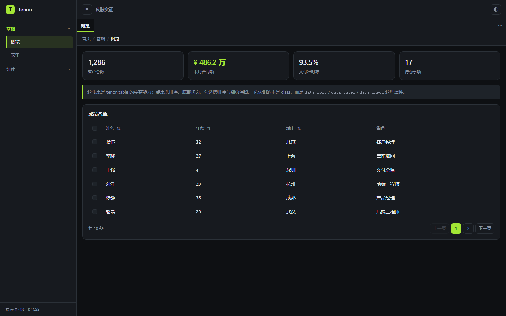
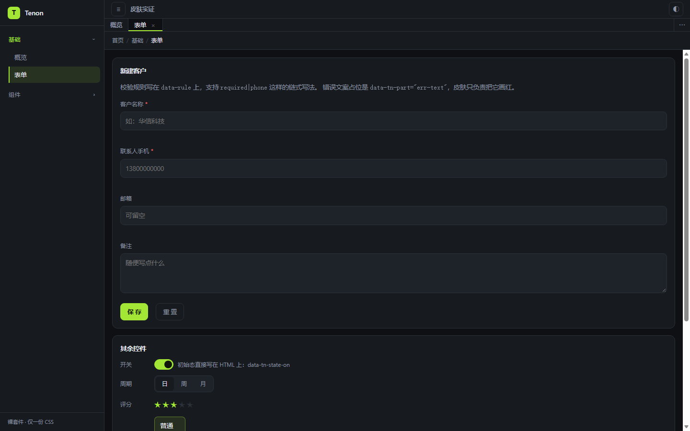
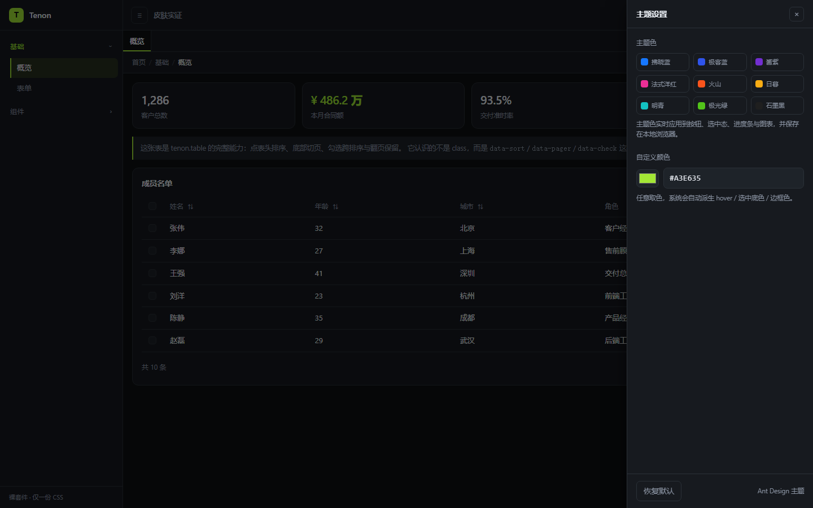
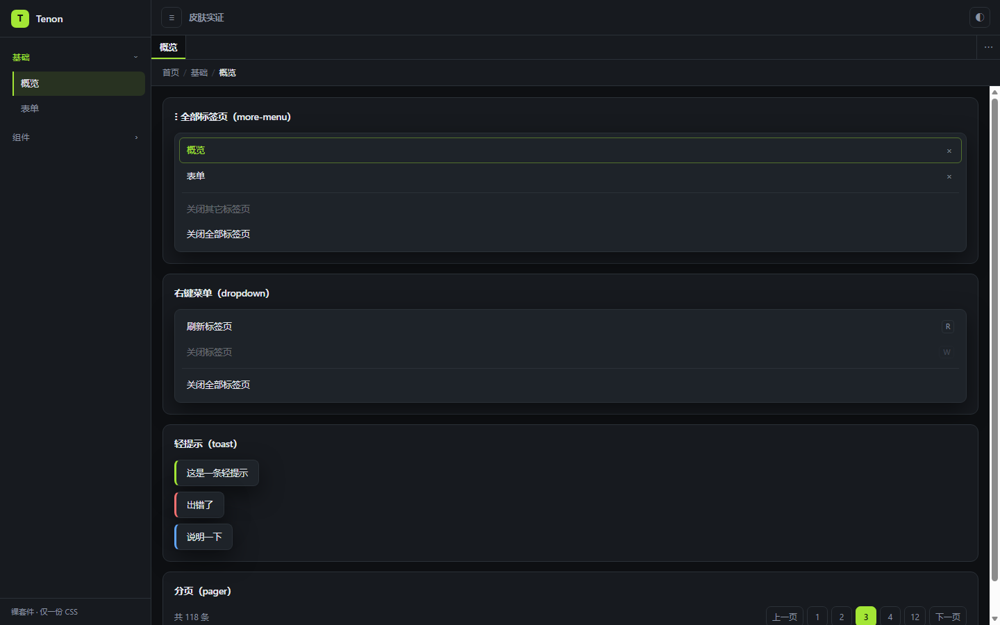

# showcase —— 换肤实证

这个目录不是框架的一部分，是**一条证据**：证明「换 UI 只换 kit + CSS」不是口号。

它做的是一件极端的事 —— **连 kit 都不写**，只写一份 CSS。

## 三条实证

| # | 主张 | 怎么证 |
|---|---|---|
| 1 | 页面可以一个类名都没有 | `index.html` / `pages/*.html` 全文无 `class` 属性，骨架靠 `tn-data-part` 定位 |
| 2 | 不接皮肤也能跑通逻辑 | 只引 `tenon.kit.js`（默认就是兜底实现 `plain`），**没有** `tenon.kit.antd.js` |
| 3 | 外观全部来自一份 CSS | `skin.css` 全文只用属性选择器，没有一个 `.class` 选择器 |

`e2e.html` 把这三条变成可跑的断言，其中最关键的一条是：

```
整页 class 属性为 0 个（这是换肤的核心证据）
```

## 怎么跑

```bash
cd <项目根>
python -m http.server 8123
```

- 看效果：<http://127.0.0.1:8123/src/showcase/>
- 跑断言：<http://127.0.0.1:8123/src/showcase/e2e.html>（31 项，31 通过）

无头模式：

```bash
msedge --headless=new --virtual-time-budget=60000 --dump-dom \
  http://127.0.0.1:8123/src/showcase/e2e.html | grep -o '通过.*失败'
```

## 目录

```
showcase/
├── index.html            外壳：侧栏 / 页头 / 页签条 / 面包屑 / 工作区，零类名
├── skin.css              皮肤：骨感深色，全部属性选择器
├── pages/                3 个页面片段（overview / form / tree）
├── pages-script/         页面业务脚本，按 data-script 懒加载
├── e2e.html              31 条断言
└── shot-*.png            四张实拍（概览 / 表单 / 主题抽屉 / 菜单样张）
```

## 同一份代码，两张脸

和 `examples/web-admin/` 对比着看最清楚：

| | `examples/web-admin`（antd 皮肤） | `showcase`（零类名皮肤） |
|---|---|---|
| 套件 | `tenon.kit.antd.js` | 无（用 `plain`） |
| 样式 | 9 份 CSS，类名选择器 | 1 份 `skin.css`，属性选择器 |
| 骨架标记 | `<div class="app">` | `<div tn-data-part="app">` |
| 页面数量 | 30 | 3 |
| 用的框架代码 | `src/core` `src/ui` `src/shell` | **完全相同的那几行** |

`src/shell/tenon.navtab.js`、`tenon.accordion.js`、`tenon.theme.js` 一行都没改过 ——
它们只认 id、`data-*` 与那几个逻辑状态名。

## 属性命名

逻辑名是驼峰（JS 习惯），落到 HTML 上一律 kebab（HTML 习惯）：

| 代码里 | HTML 里 |
|---|---|
| `setState(el, "siderCollapsed")` | `tn-data-state-sider-collapsed` |
| `setState(el, "flyoutOn")` | `tn-data-state-flyout-on` |
| `part("treeRow")` | `[tn-data-part="tree-row"]` |
| `part("errorText")` | `[tn-data-part="error-text"]` |
| `node("moreMenu")` | `tn-data-part="more-menu"` |

写页面时只需要记住一件事：**拿不准就搜 `tenon.kit.js` 里那个方法名，转成 kebab**。

## 实拍

概览（表格 / 分页 / 勾选 / 面包屑 / 页签）：



表单（校验 / 开关 / 分段 / 评分 / 选项列表）：



主题抽屉（换主色只改 `--primary` 一个变量）：



菜单样张（页签列表 / 右键菜单 / 轻提示 / 分页，都是 `kit.tpl` 产出的结构）：


